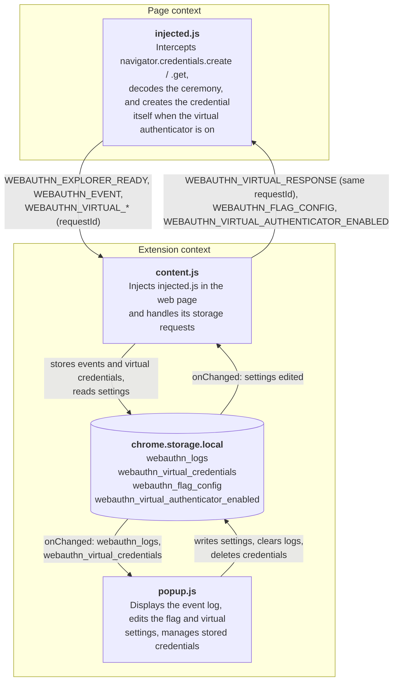

# WebAuthn Explorer

A browser extension that intercepts WebAuthn calls to `navigator.credentials.create()` and`.get()`, decodes the options and response, and shows them in a popup. It also includes a virtual authenticator that can answer the calls itself, where you can set four boolean flags to your choosing.

## Setup

Needs Node.js and a modern version of Firefox (>=133) or Chrome (>=140). The code uses external libraries and is bundled, therefore building is required:

```bash
npm install && npm run build
```

- **Chrome:** `chrome://extensions` -> enable Developer mode -> "Load unpacked" -> select this directory
- **Firefox:** `about:debugging#/runtime/this-firefox` -> "Load Temporary Add-on" -> select `manifest.json`

## Usage

Start a WebAuthn ceremony on any site, then click the extension icon. Each event shows its timestamp, URL and decoded data. "Export JSON" downloads them all and "Clear Logs" removes them.

### Virtual authenticator

Click "Enable virtual authenticator" and the extension will use its own virtual authenticator in ceremonies. Registration generates a P-256 key pair and returns a credential with `none` attestation, and authentication signs `authenticatorData || SHA-256(clientDataJSON)` with the stored private key, returning a DER-encoded ECDSA signature. Credentials are listed under "Stored Credentials" and can be deleted individually.

Private keys are stored unencrypted in `chrome.storage.local`. The extension is a tool for testing, and is only used for test accounts.

### Flag settings

These are the flags that can be changed when using the virtual authenticator:

| Flag | Default value for create | Default value for get |
|------|------------------|---------------|
| UP - User Present | True | True |
| UV - User Verified | True | True |
| BE - Backup Eligible | False | False |
| BS - Backup State | False | False |


## Architecture

Two isolated contexts that talks to eachother with `window.postMessage`:



`injected.js` has to run in the web page to intercept `navigator.credentials`, which means it doesn't have access to `chrome.storage`. So every storage operation it needs is sent to `content.js` and answered as a `WEBAUTHN_VIRTUAL_RESPONSE` with an unique `requestId`. Setting changes moves the other way. `popup.js` writes them, `content.js` sees the `chrome.storage.onChanged` and sends the changes to `injected.js`.